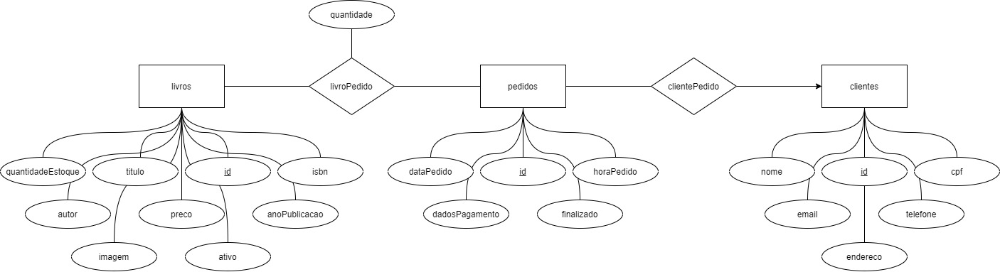

# Virtual Bookstore

Virtual Bookstore is a web-based system designed to manage bookstore orders, including customer registration, book catalog management, and order processing. The platform provides a simple interface for both sellers and buyers, supporting features such as adding books, viewing best sellers, and tracking orders from creation to completion.

This project was developed as part of a university assessment, demonstrating the integration of backend and frontend technologies to solve real-world business problems in a bookstore environment.

## Technologies Used

- Python 3
- Flask (Backend & Frontend)
- SQLAlchemy (ORM)
- MariaDB (Database)
- Docker
- HTML, CSS (Frontend)

## Requirements

- Python 3
- Docker

## Setting Up the Environment

* Run MariaDB
```
docker run -p 127.0.0.1:3306:3306 --name mariadb --restart unless-stopped -e MARIADB_ROOT_PASSWORD=SENH4 -d mariadb:latest
```

* Create the database
Use the script [`database/livrariaVirtual.sql`](database/livrariaVirtual.sql).

* Install dependencies
```
pip3 install mariadb SQLAlchemy Flask requests
```

* Run the backend service (Windows only. For other OS, see [Flask Quickstart](https://flask.palletsprojects.com/en/2.0.x/quickstart/#a-minimal-application))
```
server\run.bat
```

* Run the frontend service (Windows only. For other OS, see [Flask Quickstart](https://flask.palletsprojects.com/en/2.0.x/quickstart/#a-minimal-application))
```
frontend\run.bat
```

## Backend Routes

### Clients
- `<UrlApi>/cliente`

**POST**: Expects JSON:
```json
{
  "cpf": "12345678901",
  "nome": "client name"
}
```

- `<UrlApi>/cliente/<cpf>`

**GET**: Returns JSON:
``` json
{
	"cpf": "12345678901",
	"id": 1,
	"nome": "nome do cliente"
}
```

### Books
- `<UrlApi>/livro`

**POST**: Receive JSON of the book.
``` json
{
  "anoPublicacao": 2021,
  "autor": "autor autor",
  "estoque": 1,
  "isbn": "12345",
  "preco": 1.11,
  "titulo": "book title"
}
```
Response a JSON with the created book.
``` json
{
  "anoPublicacao": 2021,
  "autor": "autor autor",
  "estoque": 1,
  "id": 1,
  "isbn": "12345",
  "preco": 1.11,
  "titulo": "book title"
}
```

- `<UrlApi>/livro`

**GET**: Returns JSON array of books.
``` json
[
  {
    "anoPublicacao": 2021,
    "autor": "author name",
    "id": 1,
    "isbn": "1234567890123",
    "preco":  1.11,
    "titulo": "book title 1"
  },
  {
    "anoPublicacao": 2021,
    "autor": "author name",
    "id": 2,
    "isbn": "1234567890123",
    "preco": 1.11,
    "titulo": "book title 2"
  }
]
```

- `<UrlApi>/livro/maisVendidos`

**GET**: Returns JSON array of best-selling books.
``` json
[
  {
    "autor": "author name",
    "quantidade": 10,
    "titulo": "best-selling book title"
  },
  {
    "autor": "author name",
    "quantidade": 8,
    "titulo": "second best-selling book title"
  }
]
```

- `<UrlApi>/livro/<bookId>`

**GET**: Returns JSON for a specific book.
``` json
{
  "autor": "author name",
  "estoque": 1,
  "id": 1,
  "preco": 1.11,
  "titulo": "book title"
}
```

### Orders
- `<UrlApi>/pedido`

**POST**: Returns JSON with order info.
``` json
{
  "dataPedido": "Wed, 23 Jun 2021 00:42:34 GMT",
  "id": 1
}
```

- `<UrlApi>/pedido/<orderId>/add/<bookId>`

**POST**: Add book to order.

- `<UrlApi>/pedido/<orderId>/rem/<bookId>`

**POST**: Remove book from order.

- `<UrlApi>/pedido/<orderId>/cli/<cpf>`

**POST**: Assign client to order.

- `<UrlApi>/pedido/<orderId>/finalizar`

**POST**: Finalize order.

- `<UrlApi>/pedido`

**GET**: Returns JSON array of orders.
``` json
[
  {
    "dataPedido": "Wed, 16 Jun 2021 22:18:05 GMT",
    "id": 1
  },
  {
    "dataPedido": "Wed, 16 Jun 2021 22:18:06 GMT",
    "id": 2
  },
  {
    "dataPedido": "Wed, 16 Jun 2021 22:18:18 GMT",
    "id": 3
  }
]
```

- `<UrlApi>/pedido/finalizados`

**GET**: Returns JSON array of finalized orders.
``` json
[
  {
    "dataPedido": "Wed, 16 Jun 2021 22:18:05 GMT",
    "id": 1
  },
  {
    "dataPedido": "Wed, 16 Jun 2021 22:18:06 GMT",
    "id": 2
  },
  {
    "dataPedido": "Wed, 16 Jun 2021 22:18:18 GMT",
    "id": 3
  }
]
```

- `<UrlApi>/pedido/<orderId>`

**GET**: Returns JSON with order details.
``` json
{
  "cliente": {
    "nome": "client name"
  },
  "dataPedido": "Wed, 16 Jun 2021 22:18:05 GMT",
  "finalizado": true,
  "id": 1,
  "livros": [
    {
      "id": 1,
      "preco": 1.11,
      "quantidade": 1,
      "titulo": "book title"
    }
  ]
}
```

## Entity-Relationship Model


## Project Structure

- `database/`: Database scripts and ER diagram
- `frontend/`: Frontend Flask app and templates
- `server/`: Backend Flask API and business logic

## Contributors

- @marcia-santos — Márcia Cunha dos Santos
- @francielekreff — Franciele Kreff
- @reenanms — Renan Martins

